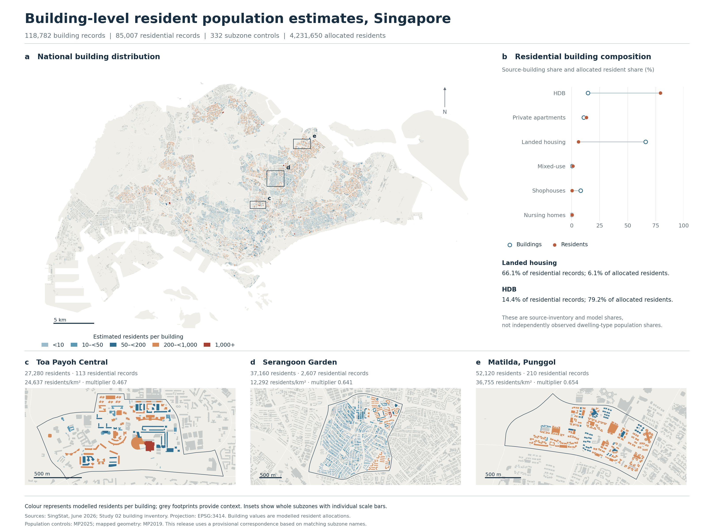
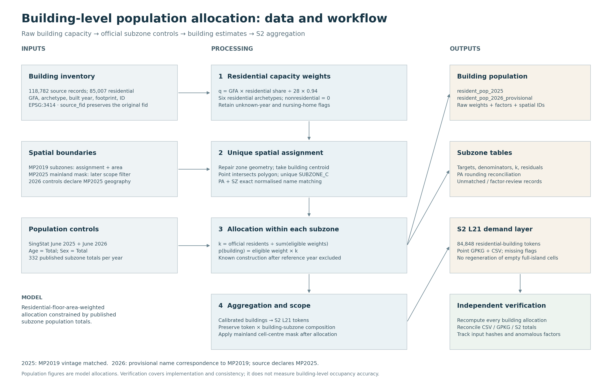
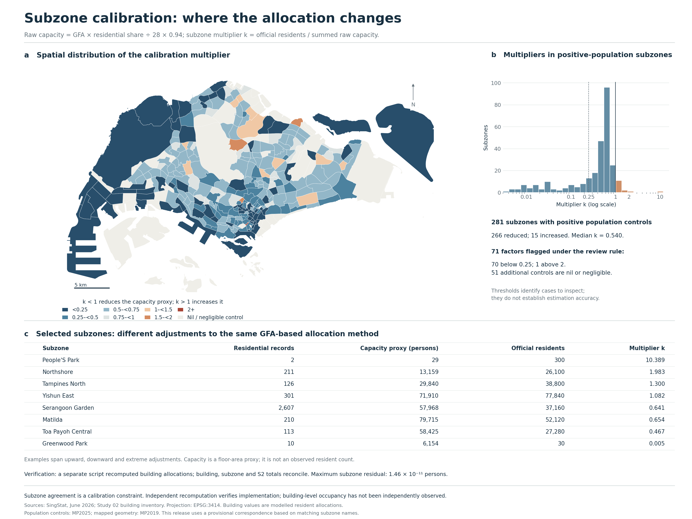

# Singapore Building-Level Population Estimates

Building footprint polygons with estimated resident populations for **2025** and **provisional 2026**, allocated from published Singapore subzone totals using residential floor-area weights.

**[Download the GeoJSON and data files →](download/README.md)** · [Method and workflow](docs/methodology.md) · [Code and reproduction](docs/reproduction.md) · [中文说明](docs/README_zh.md)

The dataset contains **118,782 building records**, including **85,007 residential-class records** used by the allocation model. Population estimates sum to **4,204,560 residents in 2025** and **4,231,650 in 2026**. These are sums of published subzone controls; the independently published national totals differ slightly because the source totals are rounded separately.



## Download

| File | Contents |
|---|---|
| [Singapore building population — GeoJSON](download/singapore_building_population.geojson?raw=1) | Building footprint polygons, both population fields, building type, subzone and allocation status; WGS84 longitude/latitude |
| [Compressed GeoJSON](download/singapore_building_population.geojson.gz?raw=1) | Identical GeoJSON compressed with gzip; decompress before use |
| [Building attributes — CSV](download/building_population_attributes.csv?raw=1) | Population fields plus GFA, construction year, residential weights and calibration factors |
| [Subzone controls — CSV](download/subzone_population_controls.csv?raw=1) | Published population controls, rounding flags and reconciliation for 332 subzones per year |
| [Metadata](download/metadata.json) · [Checksums](download/SHA256SUMS.txt) | File sizes, version, scope and SHA256 |

**2026 geography status:** the 2026 population source declares MP2025 subzones, while the current spatial assignment uses name-matched MP2019 polygons. The 2026 field is named `resident_pop_2026_provisional`. The 2025 population source and polygons both use MP2019.

Population values are model estimates in persons, including fractional values. They represent residents (citizens and permanent residents), rather than all persons. Buildings outside the available subzone polygons retain `null`, which means unallocated/unknown. An allocated zero is distinct from `null`.

## Workflow



1. Calculate residential weights from building GFA and archetype.
2. Assign each building to one subzone using its centroid in EPSG:3414.
3. Read the published **Age = Total, Sex = Total** subzone control from the annual SingStat workbook.
4. Allocate each control to eligible buildings in proportion to their residential weights.
5. Reconcile building sums, independently recalculate the allocation and export WGS84 GeoJSON.

The scripts used for the spatial calibration are in [`code/`](code/). Downloaded estimates can be independently recalculated using the published CSV inputs, without the original research workspace:

```bash
python -m pip install -r requirements.txt
python code/verify_download.py
```

## Checks and findings

All 332 subzone controls match the corresponding allocated building sums within floating-point tolerance (maximum residual below 1e-7 persons). A separate implementation reconstructs each building's allocation from GFA, archetype, year eligibility and subzone controls. Export checks also compare GeoJSON and CSV values, preserve missing values and verify file checksums. See [download verification](docs/download_verification.json) and [calibration validation](docs/validation_summary.json).

These checks establish calculation consistency. Building-level occupancy accuracy has not been measured against independent observed building populations.



## Sources and attribution

- [SingStat: Geographic Distribution](https://www.singstat.gov.sg/find-data/explore-data-themes/population/geographic-distribution/latest-news-data), June 2025 and June 2026 resident population tables. Exact snapshot URLs and SHA256 are recorded in [`data/raw/population/manifest.json`](data/raw/population/manifest.json).
- [URA: Master Plan 2019 Subzone Boundary No Sea](https://data.gov.sg/datasets/d_8594ae9ff96d0c708bc2af633048edfb/view), used for building-to-subzone assignment.
- Building geometry and attributes come from the research's compiled input inventory. The current input checksum is recorded in [metadata](download/metadata.json); complete upstream attribution has not yet been established. No new redistribution licence is assigned by this repository.

Snapshot: **15 November 2026**. The data are annual-population estimates, rather than Census 2020 counts. When referring to the 2026 layer, retain the provisional geography status.
